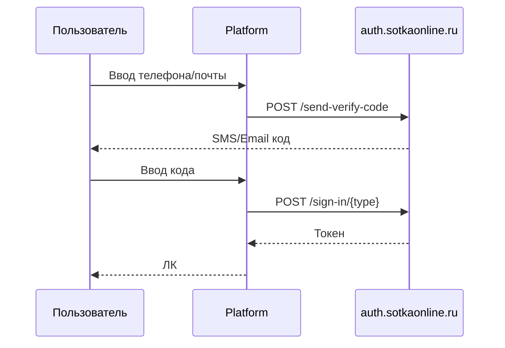
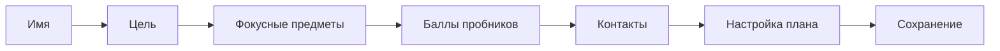
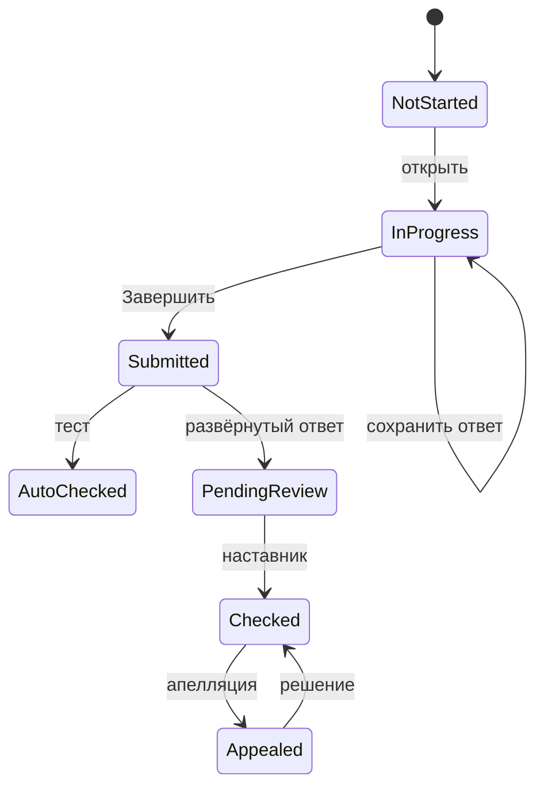

# 03. Пользовательские сценарии

> Все сценарии ЛК восстановлены по коду/API и помечены **INFERRED**, если не указано иное. Публичные сценарии — **CONFIRMED**.

---

## FLOW-01. Покупка доступа (CONFIRMED / оплата NOT_TESTED)

**Роль:** Guest / родитель.
**Цель:** получить доступ к платформе.
**Предусловия:** нет.
**Триггер:** кнопка «Купить» / «Начать обучение».

Шаги:
1. Открыть `/sotkastore`.
2. Выбрать группу «9-11 классы» или «1-8 классы».
3. Выбрать класс (11/10/9). → API `GET /store/sotka-grades`, `GET /store/sotka-courses?grade=…`.
4. Выбрать от 1 до 4 предметов. → счётчик «Выбрано N из 4»; «Далее» активна при N≥1.
5. Нажать «Далее». → выбор тарифа (Базовый/Стандарт/Про/Про+), переключатель «Месяц/Учебный год».
6. Выбрать тариф. → блок «Содержание подписки», цена, состав.
7. Заполнить данные: имя, телефон, email, VK, промокод, согласия; при необходимости — данные ребёнка/родителя.
8. Подтвердить код (SMS/письмо).
9. Оплатить картой/рассрочкой (CloudPayments).

Постусловия: создаётся доступ (`storeAccess`), аккаунт, подписка; пользователь может войти.

Альтернативы:
- «Бюджет» (0 ₽) → заявка, оплата при поступлении на бюджет.
- Промокод → `POST /promo-code/check`.
- Ошибка «Пользователь с данной почтой привязан к другому телефону» → смена телефона/обращение в поддержку.

Ошибки: невалидный телефон/почта, неверный код, отказ банка, таймаут.
Статус: UI CONFIRMED, оплата NOT_TESTED.

```mermaid
flowchart TD
  A[/sotkastore] --> B{Класс}
  B --> C[Выбор 1-4 предметов]
  C --> D[Далее]
  D --> E[Выбор тарифа]
  E --> F[Контакты + промокод]
  F --> G[Код подтверждения]
  G --> H{Оплата}
  H -->|успех| I[Доступ + аккаунт]
  H -->|ошибка| F
```

---

## FLOW-02. Вход (CONFIRMED)

**Роль:** существующий ученик/родитель.
**Предусловия:** аккаунт создан при покупке.

Шаги:
1. `/auth` → таб «Телефон» или «Почта».
2. Ввести логин.
3. «Продолжить» → `POST /send-verify-code`.
4. Ввести код из SMS/письма (обратный отсчёт, «Отправить повторно через N сек»).
5. `POST /sign-in/{type}` → сессия → редирект в ЛК.

Ошибки (CONFIRMED):
- пусто → «Это обязательное поле»;
- иностранная почта → «Авторизация по этой почте невозможна…»;
- нет пользователя → «Пользователь не найден.»;
- неверный код → «Код слишком короткий» / ошибка проверки (INFERRED).

Альтернатива: «Я тут впервые» → лид-форма или магазин.



---

## FLOW-03. Онбординг и персональный план (INFERRED)

**Роль:** новый ученик после покупки.
**Маршрут:** `/register` (10 шагов).

Шаги:
1. Имя.
2. «Какая у тебя цель?» (несколько вариантов).
3. Фокусные предметы (какие регулярно).
4. Баллы последних пробников (0..max, можно пропустить).
5. Контакты: телефон, почта, VK (или «У меня нет VK»).
6. Настройка программы: слайдер целевого балла / часов в неделю.
7. Сохранение → `POST /profile/purposes`, `/profile/first-visit`, `/profile/first-visit/courses`.

Результат: персональный план, порядок предметов (фокусные первыми), главная с планом знакомства.

Ошибки: «Значение не должно превышать N», «Некорректная почта/ссылка/номер», «Не удалось загрузить список курсов».



---

## FLOW-04. Ежедневное обучение (INFERRED)

**Роль:** ученик с активной подпиской.

1. `/mainpage` → «План на сегодня», ближайший эфир, прогресс.
2. `/daily-plan` → блоки «Теория», «Практика», «Пропущенное», «Работа над ошибками».
3. Переход в урок `/courses/:courseId/:lessonId`.
4. Просмотр видео (учёт `video-depth`), чтение статьи, тест.
5. Практика/эфир → домашка.
6. Домашка `/homework/:hwId` → ответы → «Завершить» → результат.
7. Прогресс и статистика обновляются.

Правила: теория засчитывается при просмотре видео; практика/онлайн-занятие — при выполненной домашке.

---

## FLOW-05. Выполнение домашнего задания (INFERRED)

**Предусловия:** доступен урок/практика, ДЗ открыто.

Шаги:
1. `/homework` → фильтр «К выполнению» → выбрать ДЗ.
2. Задание №1: прочитать условие (текст/изображение), ввести ответ.
3. «Далее» / «Назад»; автосохранение («Сохранение…» → «Ответ сохранён»).
4. «Завершить» → подтверждение (INFERRED).
5. Автопроверка тестов; развёрнутые ответы — «Проверить»/«Отправить наставнику».
6. Результат: баллы, правильные ответы, статус проверки.
7. При несогласии — «Подать апелляцию» + комментарий.

Состояния: «Не удалось завершить домашнюю работу. Попробуй ещё раз», «Ошибка при сохранении», «Ошибка завершения», «Задание на проверке», «Задание проверено».



---

## FLOW-06. Самопроверка (INFERRED)

1. `/selfcheck/:hwId`.
2. Просмотр своего решения и критериев.
3. Ползунок балла (0..max).
4. «Подвести итоги» → суммарный балл.
5. Альтернатива: «Отправить наставнику» (если доступно и нет тарифных ограничений).

---

## FLOW-07. Пробник (INFERRED)

1. `/samples` → «Пробники»/«Контрольные».
2. «Пройти пробник» → задания формата экзамена.
3. Ответы → завершение.
4. Ручная проверка экспертами (90+).
5. Результат и статистика.

---

## FLOW-08. Банк заданий (CONFIRMED)

**Роль:** Guest.
**Маршрут:** `/bank-zadaniy`.

1. Выбрать «я сдаю ЕГЭ» / «я сдаю ОГЭ».
2. Выбрать предмет (профильная математика / русский).
3. Выбрать тему.
4. «Решать» → `GET /public-task-bank/homeworks/{id}`.
5. Вариант: навигация 1..4, задание, поле «Ответ».
6. «Ответить» → показ «Правильный ответ N», «Продолжить», прогресс «1/4».
7. По завершении — итог (INFERRED).

Особенность: правильные ответы передаются клиенту, проверка на клиенте.

---

## FLOW-09. Дуэль (INFERRED)

1. `/duels` → «Выбери предмет» → «Начать дуэль».
2. `POST /duels/start` → «Мы уже ищем тебе соперника».
3. Соперник найден → уведомление.
4. Прохождение теста (`/duels/:courseId`).
5. `POST /duels/:id/submit`.
6. Результат: победа/поражение/ничья; история.

Альтернатива: соперник не найден → «Дуэли в ожидании».

---

## FLOW-10. Магазин и тамагочи (INFERRED)

1. `/coinshop` → «Все»/«Избранное»/«Мои покупки».
2. Товар: «В наличии N шт.», «Купить», «Предпросмотр», «Скоро в продаже», «Нет в наличии».
3. `POST /coin-product/buy` → списание соткакоинов, покупка.
4. Тамагочи: уход, лечение, заморозка (`buy-freeze`), включение/выключение.
5. Питомец приносит монетки; при игнорировании болеет.

Ошибки: «Не хватает монет», «1 шт. в руки», «Больше не жду :(».

---

## FLOW-11. Реферальная программа (INFERRED)

1. `/referral` → ссылка, «Скопировано!».
2. Друг покупает пакет.
3. Начисление: +500 ₽ (вывод через 30 дней) или 10% на месяц.
4. «Текущий баланс», «Доступно для вывода сегодня».
5. «Вывести на карту» → номер карты → `POST /refund/*Withdrawal`.

Ограничение: вывод через 30 дней после оплаты приглашённым.

---

## FLOW-12. Продление/смена подписки (INFERRED)

1. `/profile/subscriptions`.
2. Статусы: активна / закончилась / подходит к концу.
3. «Продлить подписку» → `POST /store/renew`; «Невозможно продлить эту подписку» — ограничение.
4. Смена набора предметов → `POST /store/updateAccess`, `/store/checkUpdate`.
5. Добавление курсов → `/store/addCoursesToAccesses`, `/store/checkAddCourses`.

---

## FLOW-13. Обращение в поддержку/наставнику (INFERRED)

1. `/chat` → чат с наставником/тьютором; `/moz` — поддержка.
2. Отправка текста/файлов.
3. Показ нагрузки: «Ответ в течение …».
4. Уведомление о новом сообщении.

---

## FLOW-14. Просмотр статистики родителем (INFERRED)

1. Родитель входит в аккаунт (роль parent).
2. `GET /parent/statistic/courses` → список курсов ребёнка.
3. `GET /parent/statistic/courses/lessons` → занятия.
4. Отчёт: активность, успеваемость, время просмотра, решённые задания.

---

## FLOW-15. Регистрация преподавателя (INFERRED)

1. `/teacher/register` → email + пароль + подтверждение.
2. `POST /teacher/register`.
3. Подтверждение email (`/teacher/email/verify`), повторная отправка.
4. Вход `/teacher/sign-in`; восстановление пароля.
5. Отдельный кабинет преподавателя (не исследован).

---

## FLOW-16. Лид-форма консультации (CONFIRMED)

1. Кнопка «Бесплатная консультация» / «Записаться на диагностику».
2. Выбор класса, ввод телефона.
3. Согласие с политикой ПДн.
4. Отправка → обещание перезвонить 8:00–22:00 МСК, пробный урок.
5. Альтернативные каналы: телефон 8-800, Telegram, MAX.

Статус: форма CONFIRMED, отправка NOT_TESTED (не отправляли реальную заявку).
