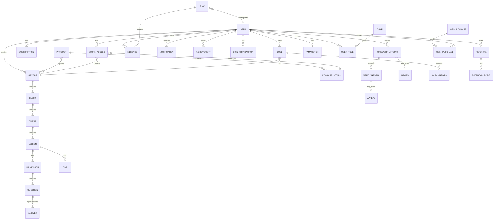

# 05. Модель данных

> Модель восстановлена по публичным API, JS-бандлу и UI. Поля с пометкой **(API)** подтверждены ответом API; **(JS)** — найдены в коде; **(INF)** — логически необходимы.

## 1. Сущности верхнего уровня

## 2. Пользователь и роли

### Entity: User
| Поле | Тип | Обяз. | Описание | Источник |
|---|---|---|---|---|
| id | int | да | PK | API |
| first_name | string | да | имя | API/JS |
| email | string | да | российская почта | JS |
| phone_number | string | да | телефон | JS |
| vk | string | нет | ссылка VK | JS |
| telegram | string | нет | Telegram | JS |
| grade | int | да | класс (1–11) | JS |
| year_type | int | да | тип учебного года | JS |
| is_trial | bool | да | пробный доступ | JS |
| is_tutor | int | да | 1 = тьютор | JS |
| is_active | bool | да | активен | JS |
| has_tutor | bool | да | есть тьютор-продукт | JS |
| avatar | file | нет | аватар | JS |
| birthday | date | нет | дата рождения | INF |
| purposes | json | нет | цели/баллы | JS |
| created_at / updated_at | datetime | да | | API |

### Entity: Role
| Поле | Тип | Описание |
|---|---|---|
| id | int | PK |
| code | enum | student, parent, tutor, teacher, mentor, curator, support, admin |
| name | string | отображаемое имя |

> Роли `parent`, `mentor`, `curator`, `admin` — **INFERRED**; подтверждены только `student`, `trial`, `tutor`, `teacher` (код/эндпоинты).

### Entity: UserRole
- user_id, role_id, scope (course_id?) — **INF**.

## 3. Каталог и доступ

### Entity: Product
| Поле | Тип | Описание | Источник |
|---|---|---|---|
| id | int | PK | API |
| title | string | «Октябрь–Май | ЕГЭ 2027 + Нокаут» | API |
| type | int | тип продукта | API |
| exam_type | int | 9/11 (ОГЭ/ЕГЭ) | API |
| year_type | int | год | API |
| duration_type | int | 1/9 (месяц/год) | API |
| courses | int | кол-во предметов (4) | API |
| has_prof_courses | bool | курсы профессий | API |
| bonus_id | int | бонус | API |
| is_trial | bool | trial | API |
| is_hidden | int | скрыт | API |
| active | int | активен | API |
| canRenew / canUpdate | bool | продление/смена | API |
| access_start_at / access_end_at | datetime | доступ | API |
| duration_start_at / duration_end_at | datetime | период обучения | API |
| options | ProductOption[] | тарифы | API |

### Entity: ProductOption
| Поле | Тип | Описание |
|---|---|---|
| id | int | PK |
| product_id | int | FK |
| title | string | Базовый/Стандарт/Про/Про+ |
| price | int | цена, ₽ |
| full_price / credit_price | int? | полная/кредитная цена |
| product_type | int | 1..4 |
| is_hidden | int | скрыт |
| discount / discount_promo | json? | скидки |
| cards | array | условия рассрочки |

### Entity: Course
| Поле | Тип | Описание | Источник |
|---|---|---|---|
| id | int | PK | API |
| name | string | «Русский язык | ЕГЭ 2027» | API |
| slug | string | URL-slug | API |
| subject_id / super_subject_id | int | предмет | API |
| exam_type | int | 9/11 | API |
| year_type | int | год | API |
| land_link | string | лендинг | API |
| is_active / is_hidden | bool | | API |
| is_basic | bool | базовая математика | API |
| is_special / is_super_course / is_main_course / is_prof_course | bool | типы | API |
| is_middle_school / is_trial / is_nokaut / is_summer_course | bool | | API |
| can_change_teacher | bool | смена преподавателя | API |
| with_ai_assist / with_ai_review | bool | ИИ | API |
| with_tutors | bool | тьютор | API |
| for_strike | bool | страйки | API |
| has_public_task_bank | bool | публичный банк | API |
| showInTimeTable | bool | расписание | API |
| subject / super_subject | object | вложенные | API |

### Entity: Subject
- id, slug (`Russian`, `Maths_profile`), name, super_subject_id, exam_type, is_hidden.

### Entity: StoreAccess
| Поле | Тип | Описание |
|---|---|---|
| id | int | PK |
| user_id | int | FK |
| product_id / product_option_id | int | FK |
| access_start_at / access_end_at | datetime | доступ |
| duration_start_at / duration_end_at | datetime | обучение |
| status | enum | active/expired/pending |
| can_update / can_renew | bool | |

### Entity: Subscription
- Проекция StoreAccess для UI: статус, дней осталось, продукт, специальная подписка.

### Entity: PromoCode
- code, discount_type, value, product_id, valid_from/to, usage_limit — **INF**.

### Entity: Payment
- id, user_id, store_access_id, amount, currency, provider (`cloudpayments`), method (card/installment), status (pending/paid/failed/refunded), external_id, created_at — **INF**.

## 4. Обучение

### Entity: Block
- id, course_id, title, order, type (вводный/основной/доп.), months — **INF**.

### Entity: Theme
- id, block_id, title, order, tags — **INF**.

### Entity: Lesson
| Поле | Тип | Описание |
|---|---|---|
| id | int | PK |
| course_id / block_id / theme_id | int | FK |
| name | string | название |
| type | enum | theory/practice/webinar/record/test |
| start_at | datetime | эфир |
| duration | int | минуты |
| video_url / article | text | контент |
| timecodes | json | таймкоды |
| is_free / is_pro | bool | доступ |
| order | int | порядок |

### Entity: Progress
- user_id, course_id, lesson_id, video_depth, life_depth, theory_done, practice_done, updated_at — **JS/INF**.

### Entity: File
- id, url, name, mime_type, size, type (image/pdf/video), owner — **API** (пример из банка).

### Entity: LibraryItem
- id, subject, exam_type, title, type (конспект/формулы/схема/пособие), file_id — **JS**.

### Entity: TextbookTopic
- id, subject, title, slug, content, subtopics, views — **INF** (публичный учебник).

## 5. Домашние задания и проверка

### Entity: Homework
| Поле | Тип | Описание | Источник |
|---|---|---|---|
| id | int | PK | API |
| course_id / lesson_id | int | FK | INF |
| title | string | | API |
| type | enum | homework/sample/tag/duel | INF |
| deadline_at | datetime | дедлайн | INF |
| min_max_mode | bool | адаптивное | INF |
| is_pro | bool | ДЗ Про | INF |
| questions | Question[] | | API |

### Entity: Question
| Поле | Тип | Описание | Источник |
|---|---|---|---|
| id | int | PK | API |
| title | string | номер задания | API |
| text / additional_text | text | условие | API |
| help_text | text? | подсказка | API |
| answer_type | enum | string/textarea/file/test | API |
| is_home_work | bool | | API |
| mandatory | bool | обязательный | API |
| image / additional_images / help_files / help_image | File | вложения | API |
| right_answers | Answer[] | правильные ответы | API |
| kim | int | номер КИМ | JS |
| difficulty | enum | сложность | JS |
| max_score | int | макс. балл | JS |

### Entity: Answer (эталон)
- id, text, additional_text, score, image — **API**.

### Entity: HomeworkAttempt
- id, user_id, homework_id, status (not_started/in_progress/submitted/pending/checked), score, started_at, completed_at — **INF**.

### Entity: UserAnswer
- id, attempt_id, question_id, value, files, is_correct, score, saved_at — **INF**.

### Entity: Review (проверка наставником)
- id, attempt_id, reviewer_id, status, score, comment, reviewed_at — **INF**.

### Entity: Appeal
- id, user_answer_id, user_id, comment, status (pending/accepted/rejected), resolution, created_at — **INF**.

### Entity: SelfCheck
- attempt_id, scores_by_question, total, submitted_at — **INF**.

## 6. Пробники и дуэли

### Entity: Sample (Trial)
- id, course_id, month, title, deadline_at, status — **JS/INF**.

### Entity: Duel
| Поле | Тип | Описание |
|---|---|---|
| id | int | PK |
| course_id | int | FK |
| user_id / opponent_id | int | участники |
| status | enum | waiting/active/finished |
| score_user / score_opponent | int | счёт |
| result | enum | win/lose/draw |
| started_at / finished_at | datetime | |

### Entity: DuelAnswer
- duel_id, question_id, user_id, value, is_correct — **INF**.

## 7. Коммуникации

### Entity: Chat
- id, type (mentor/tutor/support/community), course_id?, created_at — **INF**.

### Entity: ChatParticipant
- chat_id, user_id, role — **INF**.

### Entity: Message
| Поле | Тип | Описание |
|---|---|---|
| id | int | PK |
| chat_id | int | FK |
| sender_id | int | FK |
| text | text | |
| files | File[] | вложения |
| read_at | datetime? | прочитано |
| created_at | datetime | |

### Entity: Notification
| Поле | Тип | Описание |
|---|---|---|
| id | int | PK |
| user_id | int | FK |
| type | enum | chat_message/homework_deadline_today/homework_deadline_1d/homework_checked/probnik_deadline_1d/probnik_checked/webinar_starting_soon/subscription_ending |
| title / body | string | |
| entity_type / entity_id | string/int | связанный объект |
| read_at | datetime? | |
| created_at | datetime | |

## 8. Геймификация

### Entity: CoinTransaction
- id, user_id, amount (+/-), reason (task/lesson/progress/shop/tamagotchi), ref_id, created_at — **INF**.

### Entity: CoinProduct
| Поле | Тип | Описание |
|---|---|---|
| id | int | PK |
| title | string | |
| price | int | коины |
| in_stock | int | наличие |
| per_user_limit | int | «1 шт. в руки» |
| available_for | enum | all/standard/pro/proplus |
| status | enum | available/soon/out_of_stock |
| image | File | |

### Entity: CoinPurchase
- id, user_id, product_id, price, status, created_at — **INF**.

### Entity: Achievement
- id, code, title, description, condition, icon, rarity — **INF**.

### Entity: UserAchievement
- user_id, achievement_id, earned_at — **INF**.

### Entity: Tamagotchi
| Поле | Тип | Описание |
|---|---|---|
| user_id | int | PK/FK |
| state | enum | base/sad/weak/tired/dirty/unknown |
| health / hunger / cleanliness | int | |
| is_frozen | bool | заморозка |
| last_fed_at | datetime | |
| coins_earned | int | |

## 9. Рефералы и выплаты

### Entity: Referral
- id, user_id, code, link, balance, total_earned, created_at — **INF**.

### Entity: ReferralEvent
- id, referral_id, invited_user_id, event (signup/payment), amount, status, available_at (payment+30d) — **INF**.

### Entity: Withdrawal
- id, user_id, amount, card_number (masked), status, requested_at, processed_at — **INF**.

## 10. Статистика

### Entity: DailyStat
- user_id, date, theories_done, practices_done, homeworks_done, samples_done, minutes_watched, coins — **INF**.

### Entity: PublicStatReport
- id, period, activity, performance, user_display, is_public — **INF**.

## 11. Перечисления (enum)

| Enum | Значения |
|---|---|
| ExamType | 9 (ОГЭ), 11 (ЕГЭ) |
| Grade | 1..11 |
| Tariff | basic, standard, pro, proplus, budget |
| SubscriptionStatus | active, ending_soon, expired, pending |
| HomeworkStatus | not_started, in_progress, submitted, pending_review, checked, appealed |
| DuelStatus | waiting, active, finished |
| DuelResult | win, lose, draw |
| NotificationType | см. Notification.type |
| ChatType | mentor, tutor, support, community |
| CoinProductStatus | available, soon, out_of_stock |
| TamagotchiState | base, sad, weak, tired, dirty, unknown |

## 12. Ограничения и индексы (рекомендации)

- Уникальность: `users.email`, `users.phone_number`, `promo_codes.code`, `referrals.code`.
- Составные индексы: `(user_id, course_id)`, `(user_id, homework_id)`, `(chat_id, created_at)`, `(user_id, read_at)`.
- Каскадное удаление ответов при удалении попытки.
- Мягкое удаление пользователей (`deleted_at`), чтобы сохранить статистику.
- Версионирование контента (курс/урок/вопрос) — для сохранения исторических результатов.
