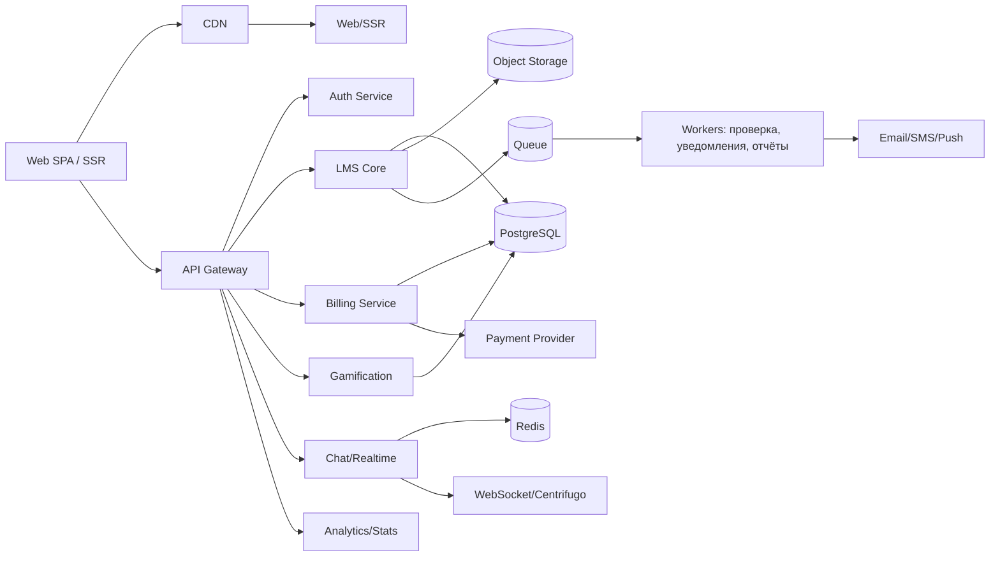

# 09. Спецификация реализации

Документ разделён на:
- **A. Observed requirements** — что реально наблюдалось.
- **B. Recommended implementation** — рекомендации для аналога.
- **C. Unknown architecture** — внутренние решения оригинала.

---

## A. Observed requirements

### A.1 Функциональные требования (высокоуровневые)

| ID | Требование | Источник |
|---|---|---|
| FR-001 | Публичный сайт с направлениями, тарифами, преподавателями, блогом, учебником, ГДЗ, банком заданий | UI |
| FR-002 | Магазин: выбор класса → 1–4 предметов → тариф → контакты → промокод → оплата | UI |
| FR-003 | Вход по телефону/российской почте с OTP | UI |
| FR-004 | ЛК: главная, план, курсы, уроки, домашки, пробники, банк, библиотека, статистика, расписание, чаты, дуэли, магазин, достижения, реферал, профиль | JS/API |
| FR-005 | Урок: видео + статья + тест + ДЗ + прогресс | JS |
| FR-006 | ДЗ: вопросы, автосохранение, автопроверка, ручная проверка, апелляция, самопроверка | JS |
| FR-007 | Пробники с ручной проверкой | UI/JS |
| FR-008 | Публичный банк заданий с проверкой ответов | UI/API |
| FR-009 | Геймификация: коины, ачивки, страйки, дуэли, тамагочи, магазин | JS |
| FR-010 | Реферальная программа с балансом и выводом | JS |
| FR-011 | Подписки: статусы, продление, смена набора | JS/API |
| FR-012 | Уведомления in-app + real-time + SMS/email OTP | JS/UI |
| FR-013 | Роли: ученик, trial, тьютор, преподаватель, родитель | JS/API |

### A.2 Нефункциональные (наблюдаемые)

- SPA на React (webpack chunks), Mantine UI.
- API: Laravel-подобные ответы (`{"message":"Unauthenticated."}`), REST `/api/v1`, `/api/v3`.
- Auth-сервис отдельный (`auth.sotkaonline.ru`).
- Real-time через Centrifugo/Pusher-протокол.
- Файлы — Yandex Cloud Storage с presigned URL.
- Публичный сайт — SSR/SSG (Astro/аналоги; в HTML видны `_astro` ассеты).

### A.3 API-группы (OBSERVED)

| Группа | Примеры |
|---|---|
| Auth | `/auth`, `/sign-in`, `/send-verify-code`, `/logout`, `/teacher/*` |
| Profile | `/profile`, `/profile/purposes`, `/profile/storeAccesses`, `/profile/change-email/*`, `/profile/revoke-tokens`, `/profile/voucher/history` |
| Catalog | `/course`, `/courses`, `/course/{id}/months`, `/theme`, `/lessons/*`, `/schoolbooks` |
| Homework | `/homeworks`, `/homework/{id}`, `/save-answer`, `/complete`, `/requests`, `/custom-*`, `/answers/reset`, `/appeal` |
| Samples | `/trial`, `/homeworks`, `/homework/{id}/result` |
| Task bank | `/tagsBank`, `/public-task-bank/courses`, `/public-task-bank/homeworks/{id}` |
| Statistics | `/statistics`, `/statistics/{id}`, `/mainpage/statistic-by-month`, `/profile/progress/today` |
| Plan | `/study-plan`, `/study-plan/missed` |
| Calendar | `/calendar`, `/calendar/month`, `/course/{id}/lessons/calendar` |
| Chat | `/chat/list`, `/chat/single`, `/chat/{id}/message`, `/chat/moz`, `/chat/workload` |
| Duels | `/duels`, `/duels/start`, `/duels/{id}/submit`, `/duels/{id}/result` |
| Coins | `/coin-product`, `/coin-product/{id}/favourite`, `/coin-product/buy` |
| Tamagotchi | `/tamagotchi/*`, `buy-freeze`, `enable`, `disable`, `treat-effect`, `treat-weakness` |
| Achievements | `/achievements` |
| Referral | `/referral`, `/referral/history`, `/referral/own`, `/stats/*`, `/refund/*` |
| Store | `/store/sotka-grades`, `/store/sotka-courses`, `/store/sotka-products`, `/store/check*`, `/store/renew`, `/store/updateAccess`, `/store/addCoursesToAccesses` |
| Promo | `/promo-code/check`, `/promotions/demo-access*` |
| Notifications | `/notifications`, `/centrifugo/token` |
| Parent | `/parent/statistic/courses`, `/parent/statistic/courses/lessons` |
| Teacher | `/teacher/register`, `/sign-in`, `/forgot-password`, `/password-reset`, `/email/verify`, `/email/resend` |
| Tutor | `/tutors/register` |
| Geo | `/data/cities`, `/data/clean/address` |
| Misc | `/global/settings`, `/quotes`, `/feedback`, `/modals`, `/grant-assigment/*`, `/hochuStat/getUniversity`, `/interview` |

---

## B. Recommended implementation

> Это рекомендации, а не описание оригинальной архитектуры.

### B.1 Архитектура (high-level)

### B.2 Frontend-модули

- `public-site` (SSR/SSG): лендинги, SEO, блог, учебник, ГДЗ, банк.
- `store` (SPA): конфигуратор и checkout.
- `platform` (SPA):
  - `auth`, `onboarding`, `main`, `daily-plan`, `courses`, `lesson`, `homework`, `samples`, `tasks`, `library`, `statistics`, `calendar`, `chat`, `duels`, `coinshop`, `achievements`, `referral`, `profile`, `notifications`, `tamagotchi`.
- Общие: `ui-kit`, `api-client`, `auth-store`, `realtime-client`, `analytics`.

### B.3 Backend-модули

| Модуль | Ответственность |
|---|---|
| Identity | пользователи, роли, OTP, сессии, токены |
| Catalog | предметы, курсы, блоки, темы, уроки, материалы |
| Learning | прогресс, попытки, ответы, проверка |
| Assessment | тесты, критерии, оценки, апелляции |
| Billing | продукты, опции, промокоды, платежи, доступы, продления |
| Gamification | коины, ачивки, страйки, магазин, тамагочи |
| Social | чаты, дуэли, рефералы |
| Notifications | шаблоны, каналы, предпочтения |
| Analytics | статистика, отчёты, публичные профили |
| Admin | контент, пользователи, модерация, финансы |

### B.4 Доменная модель

См. `05_Data_Model.md`. Ключевые агрегаты: User, Course, Lesson, HomeworkAttempt, StoreAccess, Duel, Chat, CoinAccount.

### B.5 API (рекомендуемые группы)

- REST (OpenAPI 3.1) + JSON; версии `/v1`.
- Auth: OTP, refresh, revoke.
- Идемпотентность платёжных и завершающих операций (`Idempotency-Key`).
- WebSocket-каналы: `user:{id}`, `chat:{id}`, `duel:{id}`.
- Пагинация cursor-based для лент/историй.

### B.6 База данных

- PostgreSQL (основная), Redis (кэш, сессии, real-time), S3 (файлы), ClickHouse (аналитика) — рекомендация.
- Партиционирование `answers`, `notifications`, `coin_transactions` по времени.
- JSONB для `purposes`, `timecodes`, `settings`.
- Версионирование контента (курсы/вопросы) для исторических результатов.

### B.7 Аутентификация/авторизация

- Телефон/email OTP + JWT access/refresh.
- RBAC + ABAC (доступ к курсу через StoreAccess).
- Проверка прав на каждом эндпоинте: `user_id`, `course_id`.
- Rate limiting на OTP и отправку сообщений.
- 2FA для админов.

### B.8 Фоновые задачи

- Проверка ДЗ (авто) → очередь.
- Распределение ручной проверки по нагрузке наставников.
- Напоминания о дедлайнах и эфирах.
- Истечение подписок, продления.
- Начисления коинов/ачивок/страйков.
- Пересчёт статистики.
- Реферальные начисления и доступность вывода (payment+30d).
- Генерация отчётов.

### B.9 Уведомления

- Outbox-паттерн + очередь.
- Шаблоны с локализацией.
- Каналы: in-app, email, SMS, push, Telegram.
- Настройки предпочтений и quiet hours.

### B.10 Файлы

- Presigned upload/download.
- Антивирус-скан, лимиты размера/типа.
- Отдельные бакеты для публичных и приватных файлов.

### B.11 Поиск

- Полнотекстовый поиск по учебнику/блогу/библиотеке (Postgres FTS или Meilisearch).
- Фильтры по предмету/классу/типу.
- Индексация контента при публикации.

### B.12 Платежи

- Провайдер с токенизацией и вебхуками.
- Идемпотентность, сверка, возвраты.
- Рассрочка через партнёров, статусы заявок.

### B.13 Безопасность

- HTTPS, HSTS, CSP.
- Хеширование паролей (Argon2id) для teacher.
- Шифрование PII, маскирование в логах.
- Аудит действий админов.
- Защита от перебора OTP, капча.
- GDPR/152-ФЗ: согласия, экспорт/удаление данных.

### B.14 Масштабирование

- Горизонтальное масштабирование API, stateless.
- CDN для статики/видео.
- Очереди для пиков (пробники, вебинары).
- Read-replicas для статистики.
- Кэш каталога и курсов.

### B.15 Логирование/мониторинг

- Structured logs, trace-id, Sentry, Prometheus/Grafana.
- Метрики: DAU, конверсия, завершение ДЗ, время проверки, ошибки платежей.
- Алерты на 5xx, очередь, платежи.

---

## C. Unknown architecture (оригинал)

| Область | Неизвестно |
|---|---|
| Backend framework | Laravel-подобные ответы, но не подтверждено |
| БД | тип/схема неизвестны |
| Хостинг | неизвестен |
| Видеохостинг | неизвестен |
| SMS/email/push провайдеры | неизвестны |
| Очереди | неизвестны |
| Кэш | неизвестен |
| Микросервисы vs монолит | неизвестно |
| Feature flags | неизвестны |
| Внутренняя админка | недоступна |
| ML/ИИ-проверка | заявлена, механика неизвестна |

---

## D. Рекомендуемый порядок реализации

1. Identity + OTP + роли.
2. Каталог + доступы (StoreAccess).
3. Плеер урока + прогресс.
4. Домашки (авто) + результаты.
5. Статистика + главная/план.
6. Платежи + магазин.
7. Ручная проверка + чат.
8. Пробники.
9. Геймификация (коины/ачивки/дуэли).
10. Реферал, тамагочи, младшие классы, B2B.