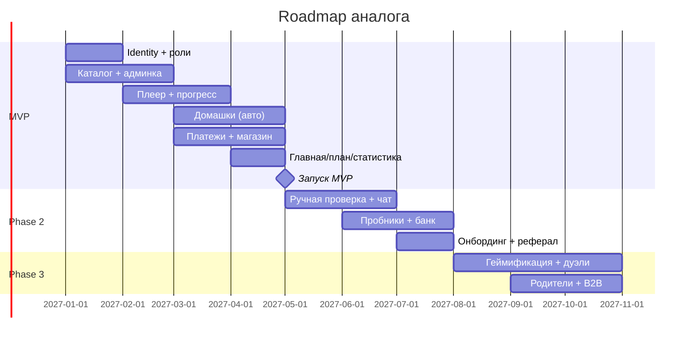

# 10. MVP и roadmap

Приоритеты: **P0** — критично для MVP, **P1** — важно, **P2** — желательно, **P3** — позже.
Сложность: XS/S/M/L/XL.

## MVP (запуск работоспособного аналога)

Цель: ученик может купить доступ, войти, учиться по курсу, делать ДЗ, видеть прогресс; администратор — управлять контентом.

| ID | Функция | Описание | Зависимости | P | Сложность | Ценность | Риски |
|---|---|---|---|---|---|---|---|
| FR-001 | Публичный сайт (минимум) | Главная, тарифы, предметы, преподаватели, FAQ, контакты | — | P0 | M | Высокая | SEO/контент |
| FR-002 | Магазин + checkout | Класс → предметы → тариф → контакты → оплата | платежи | P0 | L | Высокая | интеграция платежей |
| FR-003 | Auth (OTP) | Вход по телефону/почте | SMS/email | P0 | M | Критичная | доставляемость |
| FR-004 | Роли/доступы | User, Student, Admin; StoreAccess | auth | P0 | M | Критичная | утечка доступа |
| FR-005 | Каталог курсов | Предметы, блоки, темы, уроки | админка контента | P0 | L | Критичная | структура контента |
| FR-006 | Плеер урока | Видео + статья + тест + прогресс | каталог | P0 | L | Критичная | видео/хранение |
| FR-007 | Домашки (авто) | Вопросы, ответы, автопроверка, результат | уроки | P0 | L | Критичная | типы заданий |
| FR-008 | Главная + план | План на день, прогресс, ближайшие эфиры | прогресс | P0 | M | Высокая | логика плана |
| FR-009 | Статистика (базовая) | Прогресс, ДЗ, занятия | события | P0 | M | Высокая | метрики |
| FR-010 | Профиль | Личные данные, подписка | auth | P0 | S | Средняя | PII |
| FR-011 | Админка контента | Курсы, уроки, вопросы, пользователи | — | P0 | L | Критичная | UI/права |
| FR-012 | Уведомления in-app | Лента + email о ДЗ/подписке | очередь | P1 | M | Средняя | шаблоны |
| FR-013 | Ручная проверка ДЗ | Очередь наставника, оценка, комментарий | ДЗ | P1 | M | Высокая | SLA |
| FR-014 | Расписание | Календарь/список занятий | уроки | P1 | M | Высокая | таймзоны |
| FR-015 | Чат с наставником | Список чатов, сообщения, real-time | realtime | P1 | L | Высокая | модерация |

## Phase 2

| ID | Функция | P | Сложность | Ценность | Риски |
|---|---|---|---|---|---|
| FR-016 | Пробники с ручной проверкой | P1 | L | Высокая | нагрузка проверяющих |
| FR-017 | Банк заданий в ЛК | P1 | M | Высокая | контент |
| FR-018 | Библиотека материалов | P1 | S | Средняя | авторские права |
| FR-019 | Самопроверка | P1 | M | Средняя | объективность |
| FR-020 | Апелляции | P1 | M | Средняя | SLA, конфликты |
| FR-021 | Онбординг/персональный план | P1 | M | Высокая | алгоритм |
| FR-022 | Реферальная программа | P2 | L | Высокая | фрод, выплаты |
| FR-023 | Геймификация: коины/ачивки/страйки | P2 | L | Средняя | баланс экономики |
| FR-024 | Магазин мерча | P2 | M | Средняя | логистика |
| FR-025 | Родительский кабинет | P2 | M | Высокая | привязка ребёнка |
| FR-026 | Публичные отчёты `/statistics/:id` | P2 | S | Средняя | приватность |
| FR-027 | Публичный банк заданий | P2 | M | Высокая (SEO) | контент |

## Phase 3

| ID | Функция | P | Сложность | Ценность | Риски |
|---|---|---|---|---|---|
| FR-028 | Дуэли | P2 | L | Средняя | матчмейкинг |
| FR-029 | Тамагочи | P3 | M | Низкая | экономика |
| FR-030 | Курсы профессий | P3 | L | Средняя | контент |
| FR-031 | Олимпиады | P3 | L | Средняя | экспертиза |
| FR-032 | B2B-кабинет | P3 | L | Высокая | продажи |
| FR-033 | Младшие классы (1–8) | P3 | L | Средняя | отдельный контент |
| FR-034 | ИИ-проверка/ассистент | P3 | XL | Высокая | качество/стоимость |
| FR-035 | Мобильные приложения | P3 | XL | Высокая | ресурсы |

## Roadmap (рекомендуемый)

## Критерии готовности MVP

- Покупка → доступ → вход → урок → ДЗ → результат работают end-to-end.
- Данные изолированы по пользователям.
- Платежи идемпотентны, есть журнал.
- Админ может создать курс/урок/вопрос без разработчика.
- Есть базовые метрики и алерты.
- Пройдены тесты безопасности (OWASP Top 10).