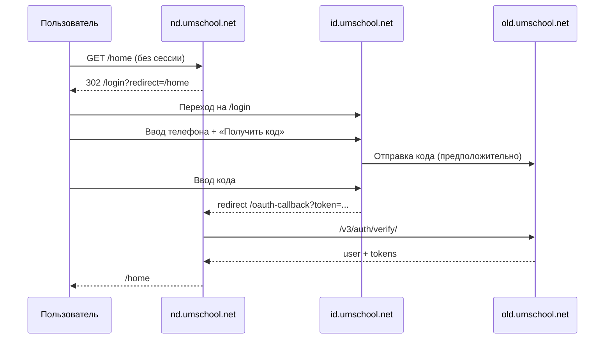
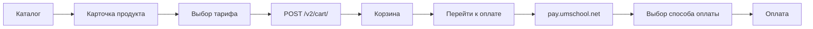
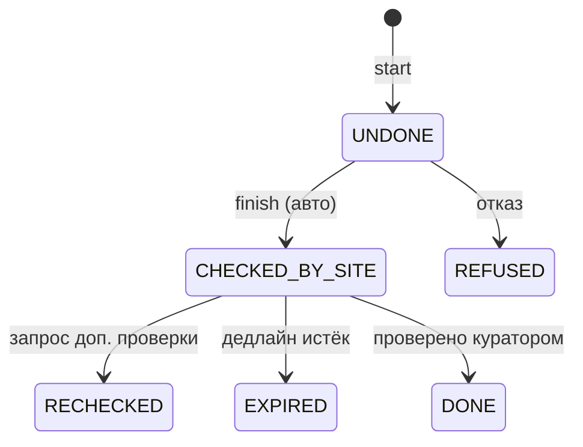

# 03. Пользовательские сценарии

Формат: ID, роль, цель, предусловия, триггер, шаги, постусловия, альтернативы, ошибки, edge cases, статус.
Все сценарии проверены на тестовом аккаунте, если не указано иное.

---

## UF-01. Вход по телефону и регистрация нового пользователя

- **Роль:** Guest → Student
- **Цель:** получить доступ в LMS
- **Предусловия:** нет активной сессии
- **Триггер:** «Войти» на публичном сайте или прямой переход на `nd.umschool.net`

| # | Действие | Экран | Реакция системы | Данные | Следующее состояние |
|---|---|---|---|---|---|
| 1 | Перейти на `nd.umschool.net/home` без сессии | SPA | Редирект на `https://nd.umschool.net/login?redirect=/home` | — | Guest |
| 2 | Нажать «Войти» | `/login` | Переход в `id.umschool.net/login?client_id=...&client_redirect=...` | OAuth-параметры | Форма входа |
| 3 | Ввести номер, нажать «Получить код» | Форма «Телефон» | Клиентская валидация; при неверном номере — «Некорректно указан номер» | phone | Ожидание кода |
| 4 | Ввести код | Форма кода | Проверка кода; для нового номера — быстрая регистрация | OTP | Student |
| 5 | Заполнить быстрые данные (если новый) | Онбординг | Создание профиля, выдача стартового уровня | имя, класс и т.п. | `/progress/class-type/selection` |
| 6 | OAuth callback | `nd/oauth-callback?token=...` | Обмен токена, запись в `auth-bridge`, редирект | access/refresh JWT | `/home` |

**Постусловия:** сессия в `nd.umschool.net`, профиль создан, доступен дашборд.
**Альтернативы:** существующий пользователь сразу попадает в LMS; выбор страны RU/BY/KZ.
**Ошибки:** «Некорректно указан номер»; неверный код; истёкший код; капча SmartCaptcha.
**Edge cases:** смена страны; номер с пробелами; повторная отправка кода; блокировка после попыток (не проверено).
**Статус:** CONFIRMED (валидация/переходы), NOT_TESTED (получение SMS/кода).

---

## UF-02. Вход по e-mail и паролю

- **Роль:** существующий Student
- **Предусловия:** аккаунт с паролем
- **Триггер:** вкладка «Почта»

| # | Действие | Экран | Реакция | Данные |
|---|---|---|---|---|
| 1 | Открыть вкладку «Почта» | `/login/email` | Поля «Почта», «Пароль» | — |
| 2 | Отправить пустую форму | — | «Поле обязательно для заполнения» под каждым полем | — |
| 3 | Ввести неверные данные | — | «Невозможно войти с предоставленными учетными данными.» | email/password |
| 4 | Ввести корректные данные | — | OAuth callback → `/home` | токены |

**Ошибки:** пустые поля; неверная пара; невалидный формат почты (сообщение `invalid_email_format` присутствует в локали, но в тесте сработала проверка пароля).
**Статус:** CONFIRMED.

---

## UF-03. Восстановление пароля

1. На `/login/email` нажать «Забыли пароль?».
2. Откроется `/recover-password`.
3. Ввести e-mail → «Восстановить».
4. Система отправляет письмо со ссылкой сброса (не проверено).
5. Переход по ссылке → установка нового пароля (не проверено).

**Статус:** CONFIRMED (форма), NOT_TESTED (письмо/сброс).

---

## UF-04. Онбординг и выбор целей

- **Роль:** Student без целей
- **Предусловия:** успешный вход
- **Триггер:** `needOnboarding`/`hasChosenGoals=false` или `/progress/class-type/selection`

| # | Действие | Экран | Реакция | Данные |
|---|---|---|---|---|
| 1 | Открыть онбординг | `/progress/class-type/selection` | «Добро пожаловать! Ответь на несколько вопросов…» | — |
| 2 | Выбрать класс | Плитки 11–5 класс | Подсветка выбора | class_year |
| 3 | Выбрать 3–5 предметов | Плитки предметов | Подсветка, счётчик (в тесте клики не зафиксированы из-за кастомных плиток) | class_types[] |
| 4 | Отметить олимпиады (опц.) | Чекбокс | — | olympiads |
| 5 | «Посмотреть курсы» / «На главную» | — | Сохранение целей, переход в каталог/главную | goals |
| 6 | Завершение | `/onboarding/complete` | Telegram-канал преподавателя, наставник, «Перейти на главную» | — |

**Постусловия:** цели сохранены, каталог и прогресс персонализированы.
**Альтернативы:** позже изменить через «Изменить предметы».
**Ошибки:** меньше 3 предметов — кнопка сохранения должна блокироваться (правило из текста, визуально не проверено).
**Edge cases:** 5+ предметов; олимпиады без предметов; повторный онбординг.
**Статус:** CONFIRMED (UI), NOT_TESTED (сохранение/лимиты).

---

## UF-05. Покупка курса: каталог → корзина → checkout

- **Роль:** Student
- **Цель:** оформить заказ (без фактической оплаты)
- **Предусловия:** авторизован

| # | Действие | Экран | Реакция | Данные |
|---|---|---|---|---|
| 1 | Открыть магазин | `/catalog` | 5 категорий | — |
| 2 | «Основной курс 26/27» → «Подробнее» | `/catalog/mg-next?...` | Список продуктов, фильтры | classTypes, classYear |
| 3 | Открыть продукт | `/catalog/mg-next/:id?...` | Карточка, тарифы, преподаватель | product_type |
| 4 | Выбрать тариф | Модалка/блок «Выбор тарифа» | Цена, список фич | rate_plan |
| 5 | «Выбрать» | — | `POST /api/v2/cart/` c productId | cart |
| 6 | Перейти в корзину | `/cart?paymentMethod=card` | Позиция, optional gift, суммы, скидки | cart |
| 7 | «Перейти к оплате» | `pay.umschool.net/payment/:uuid` | Форма контактов, способы оплаты | order |
| 8 | Заполнить контакты, выбрать способ | Checkout | Пересчёт скидки, «Оплатить» активна | order |
| 9 | Нажать «Оплатить» | Платёжный шлюз | **Не выполнялось** | — |

**Постусловия:** заказ создан, корзина привязана к `hash`, доступна ссылка на оплату.
**Альтернативы:** оплата по ссылке другим человеком; оплата по реквизитам с чеком; рассрочка.
**Ошибки:** «Продукт уже в корзине», «Нужно освободить корзину», «Не удалось добавить продукт в корзину».
**Edge cases:** пустая корзина; несколько продуктов; подарок; промокод; скидка по рефералу; конфликт подписок.
**Статус:** CONFIRMED до шага 8; PAY-009+ NOT_AVAILABLE.

---

## UF-06. Сборка комплекта предметов

1. В корзине/каталоге нажать «Собрать комплект».
2. `/catalog/:code/bundles/configure`, шаг 1 «Предметы».
3. Выбрать класс (по умолчанию 8 класс для MIDDLE).
4. Выбрать 2–8 предметов (для средней школы); для основного курса — 2–4 (по тексту баннера).
5. «Далее» → шаг 2 «Настройка».
6. Выбрать преподавателя для каждого курса, срок (1 месяц / годовой / 2-летний), тариф (Стандарт/Про/Премиум), сравнить цены.
7. «К корзине» → комплект в корзине.

**Наблюдаемые цены (пример, MIDDLE 8 класс, Математика+Физика):** 30 550 ₽ (1 месяц) и 107 820 ₽ (2 года) в блоке итога.
**Статус:** CONFIRMED (шаги 1–2, шаг 2 при выборе предметов), NOT_TESTED (добавление комплекта в корзину).

---

## UF-07. Применение промокода

1. В корзине нажать «У меня есть промокод».
2. Ввести код в `[data-testid=promo-code-input]`.
3. Нажать кнопку отправки/Enter.
4. При неверном коде: «Некорректный промокод.» + «Промокоды не суммируются. Можно использовать только один промокод.»
5. При верном коде: пересчёт суммы (не проверено).
6. Ограничения: нельзя совмещать с реферальной скидкой (текст «Чтобы применить промокод, нужно отключить скидку по реферальной программе»).

**Статус:** CONFIRMED (ошибка), NOT_TESTED (успешный промокод).

---

## UF-08. Просмотр занятия

- **Предусловия:** куплен/выдан продукт
- **Триггер:** «Посмотреть» в списке занятий

| # | Действие | Экран | Реакция | Данные |
|---|---|---|---|---|
| 1 | Открыть занятие | `/lesson/:id` | Загрузка карточки занятия | lesson_id |
| 2 | Смотреть видео | Плеер | Kinescope/YouTube/GCore iframe | video_url |
| 3 | Открыть «Таймкоды» | Блок таймкодов | Список меток времени | timecode HTML |
| 4 | Перейти по таймкоду | Плеер | Позиция видео | — |
| 5 | Изучить материалы | Блок материалов | Пусто в демо | materials[] |
| 6 | Перейти к ДЗ | Блок ДЗ | `count_task=3`, `max_exp=100` | homework |
| 7 | Оценить занятие | «Оцени занятие» | Сохранение оценки (не проверено) | rating |
| 8 | Мини-тест | Блок мини-теста | `status=NONE` в демо | mini-test |

**Правило зачёта:** «Посмотри 15 минут урока» (строка локали) — занятие считается просмотренным после 15 минут.
**Статус:** CONFIRMED (страница), NOT_TESTED (фактическое воспроизведение/оценка).

---

## UF-09. Полный цикл домашней работы

- **Предусловия:** есть ДЗ, дедлайн не истёк (в демо дедлайна нет)
- **Триггер:** «Выполнить ДЗ»

| # | Действие | Экран | Реакция | Данные |
|---|---|---|---|---|
| 1 | Открыть ДЗ | `/homework/:id` | `POST start/`, таймер `00:00:03` | start_datetime |
| 2 | Прочитать задание 1 | TEST, «Несколько правильных ответов» | Варианты «Мужской/Женский» | task |
| 3 | Нажать «Ответить» без выбора | — | «Ответ не может быть пустым», подсказка про «Пропустить» | — |
| 4 | Нажать «Пропустить» | Задание 2 | Переход к TEXT-заданию с rich-редактором | answers[] |
| 5 | Пропустить все | Задание 6 | Счётчик таймера растёт | — |
| 6 | «Завершить» | Подтверждение | `POST .../finish/` (наблюдаемо через UI) | status |
| 7 | Результат | `/completed` | `numberOfPoints=0`, `timePassed=30`, «6 заданий / 0 правильно / 1 неправильные», `0 ОП`, `studentRating` | results |
| 8 | «Проработать ошибки» | `/work-on-bugs` | Разбор заданий, «Получено баллов: 0 из 1», «Далее» | work_on_mistakes_available=true |

**Постусловия:** статус `CHECKED_BY_SITE`, `check_time_deadline` = +2 суток, доступна работа над ошибками.
**Ошибки:** пустой ответ; ошибка загрузки; «Не удалось отправить ДЗ на проверку».
**Edge cases:** дедлайн прошёл (сдать можно, но куратор не проверит); таймер истёк (автоотправка); повторный старт (продолжить/создать новое).
**Статус:** CONFIRMED.

---

## UF-10. Работа над ошибками

1. Из результата ДЗ нажать «Проработать ошибки».
2. Открывается `/homework/:id/work-on-bugs`.
3. Система показывает задания и правильные ответы.
4. «Далее» переключает задания.
5. Завершение → возврат к результатам.

**Правило:** «После каждого выполнения домашнего задания мы создаём работу над ошибками, основанную на похожих заданиях» (строка локали).
**Статус:** CONFIRMED (страница), NOT_TESTED (полный проход).

---

## UF-11. Тренажёр по карточкам

- **Предусловия:** есть карточки (42 835)
- **Триггер:** «Тренажёр» → «Начать»

| # | Действие | Экран | Реакция | Данные |
|---|---|---|---|---|
| 1 | Открыть настройки | `/training/settings` | Режим «Карточки/Заучивание», статусы (Новое 42835, Изучаю 0, Знаю 0, Повторяю 0), избранное, время, количество, «Скрыть ответы» | settings |
| 2 | «Начать» | — | `POST /cards/training/start/` → `{id:1,...}` | trainingHash |
| 3 | Сессия | `/training/cards` | Вопрос, ответ, «Не знаю/Знаю», прогресс 0/42835, счётчики, «Завершить» | card |
| 4 | Нажать «Знаю» | — | `POST /cards/training/:id/answer/` с правильным ответом; следующая карточка; `new--`, `learning++` | card status |
| 5 | Повторить | — | Следующая карточка, `GET /cards/training/count/` | — |
| 6 | «Завершить» | Модалка «Тренировка завершена» | «+50 ОП», список карточек по статусам | finish |
| 7 | Результат | `/training/result` | Вкладки «Новое/Изучаю/Знаю/Повторяю», карточки | result |

**Наблюдение:** после оценки «Знаю» карточка попала в «Изучаю», а не в «Знаю» (счётчики: new 42833, learning 2, known 0). Возможна особенность алгоритма интервального повторения; зафиксировано как есть.
**Ошибки:** «Не удалось начать тренировку», «План на тренировку выполнен», лимит карточек.
**Статус:** CONFIRMED.

---

## UF-12. Аналитика прогресса

1. `/progress` → выбрать предмет (Математика/Физика/Информатика).
2. Блок «Предсказание балла на экзамене» (0 при отсутствии пробников).
3. Вкладки:
   - «График» — disabled без данных;
   - «Темы» — список тем/подтем (например, «Повторение геометрии 7 класса», «Квадратные уравнения»);
   - «Номера КИМ» — задания по номерам;
   - «Пробные варианты» — «Пробных вариантов пока нет», «Сгенерировать».
4. Поиск по названию темы.
5. «Изменить предметы» → выбор целей.

**Статус:** CONFIRMED (темы/пустое состояние), NOT_TESTED (генератор/прохождение).

---

## UF-13. Чат с онлайн-куратором (не подтверждён)

- **Предусловия:** активный курс с доступным предметом
- **Текущее состояние:** «Диалогов нет», «Выбери предмет, по которому у тебя возник вопрос»; список предметов пуст из-за демо-курса.

**Предполагаемый сценарий (INFERRED):**
1. Выбрать предмет.
2. Создать топик.
3. Написать сообщение (WebSocket/Centrifugo).
4. Куратор отвечает; статусы «Идёт поиск…», «Все кураторы заняты», «Не рабочее время».
5. Можно передать диалог другому куратору/случайному.

**Статус:** NOT_TESTED.

---

## UF-14. Приглашение друга

1. `/referral/invite`.
2. Ознакомиться с условиями, отметить «Я принимаю условия…».
3. «Скопировать ссылку» / «Показать QR-код» / «Поделиться».
4. Друг переходит по ссылке, покупает курс.
5. Начисляются бонусы: 2 000 / 3 500 (в зависимости от срока), друг получает 1 000 / 2 000 ₽ скидки.
6. Баланс и история — `/referral/history`; вывод на карту.

**Наблюдения:** в тесте чекбокс не переключился, QR не открылся (возможно, из-за кастомного контрола/оверлея). Ссылка не сгенерирована (`eligible=false`).
**Статус:** CONFIRMED (UI/данные), NOT_TESTED (генерация ссылки/начисление).

---

## UF-15. Обмен умкоинов на промокод

1. `/loyalty` → «Выбрать промокод».
2. Доступны купоны: 50 умкоинов → 150; 150 → 500 (API).
3. Подтверждение списания (не проверено).
4. Купон появляется в `/products/my-coupons/` (пусто).
5. Мерч — внешний `store.umschool.net`.

**Статус:** CONFIRMED (данные), NOT_TESTED (обмен).

---

## UF-16. Продление/улучшение подписки (недоступно)

Маршруты `/subscriptions/:id/renewal`, `/subscriptions/:id/upgrade`. В аккаунте нет подписок. По строкам локали: ручное продление, автопродление, привязка карты, причины отключения, «Этот месяц уже входит в подписку».

**Статус:** NOT_AVAILABLE; правила — INFERRED.

---

## UF-17. Редактирование профиля и смена пароля

| # | Действие | Экран | Реакция |
|---|---|---|---|
| 1 | Открыть профиль | `/profile?scope=main` | Данные, контакты, ID, ник |
| 2 | Клик по телефону | Модалка «Подтверждение номера» | «Подтвердить» |
| 3 | Клик по e-mail | Нет действия | «Чтобы изменить почту, обратись в Чат Поддержки» |
| 4 | Клик по VK | Модалка «Подключаем Вконтакте» | «Войти c VK ID» |
| 5 | Клик по «Ник в чате» | Модалка | 3–12 символов, допустимые символы, «Сохранить» |
| 6 | Клик по «Пароль» | `id/change-password` | Новый пароль (мин. 6), повтор, «Подтвердить» |
| 7 | Вкладка «Документы» | — | Требуется дата рождения, «Заполнить данные» |

**Статус:** CONFIRMED.

---

## UF-18. Документы

1. `/documents` → «Сведения об образовательной организации».
2. Нет курсов → «Пока у тебя нет курсов. Переходи к выбору…».
3. В профиле вкладка «Документы» требует заполнить дату рождения.
4. Публичные документы: оферта, политика, согласие, лицензия, реестр ПО.

**Статус:** CONFIRMED (empty), NOT_TESTED (после покупки).

---

## UF-19. Поддержка

- Публичный сайт: чат поддержки `https://vk.me/umschoolhelp`, телефоны, e-mail.
- LMS: «Напиши куратору, в поддержку или настрой уведомления».
- FAQ, база знаний `support.umschool.net`.
- В чате: «Сейчас не рабочее время… Пн-пт 13:00–23:00, Сб-вс 11:00–23:00 МСК».

**Статус:** CONFIRMED (каналы), NOT_TESTED (обращение).

---

## UF-20. Публичная лид-форма

1. На главной/родительской странице заполнить «Твоё имя», телефон (и e-mail в форме выбора курса).
2. Отметить согласие на рассылку.
3. «Получить консультацию» / «Выбрать курс».
4. Заявка уходит в CRM (вероятно, Mindbox/CoMagic), менеджер звонит 10:00–19:00.

**Поля:** `full_name`, `phone`, `email` (опционально), `agreed`, honeypot `additional-field-123456789`.
**Статус:** CONFIRMED (поля), NOT_TESTED (отправка).

---

## UF-21. Публичный банк заданий

1. `/free/bank-zadaniy/` — 76 158 заданий.
2. Фильтры: Экзамен (ЕГЭ/ОГЭ), Предмет, Раздел, Тема, Часть экзамена, Номер КИМ, Источник, Нерешённые, Избранные.
3. «Сбросить ответы».
4. Задание: условие, варианты/поле ответа, «Проверить», «Решение».
5. Результат проверки и статистика правильных ответов (API `right_answers`, `correct_answers_statistic`).

**Статус:** CONFIRMED (API/UI), NOT_TESTED (ввод ответа — кастомный контрол).