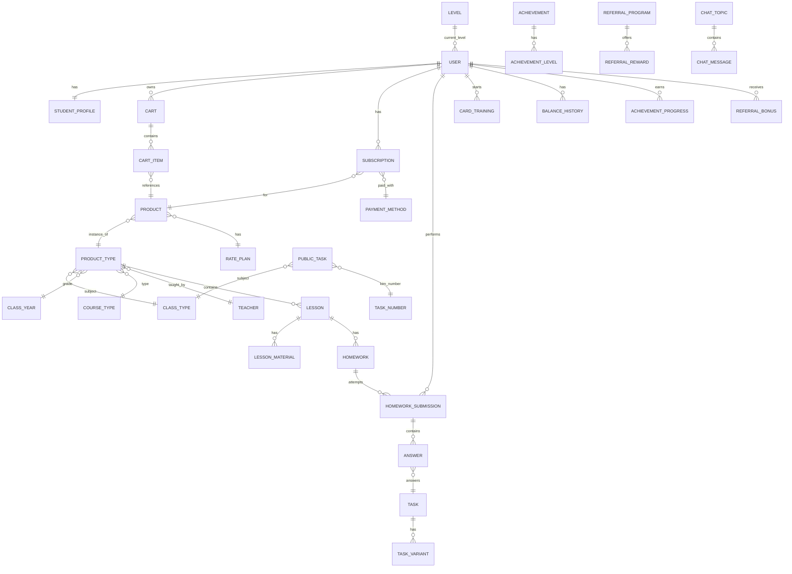

# 05. Модель данных

Модель восстановлена по ответам API `old.umschool.net`, публичным эндпоинтам и UI. Поля приведены в `snake_case` (API) и `camelCase` (публичные/некоторые эндпоинты) — в реальном API встречаются оба стиля.
Типы указаны предположительно по значениям. `?` — необязательное поле.

---

## 1. Пользователь и профиль

### User / Student
| Поле | Тип | Обяз. | Описание |
|---|---|---|---|
| id | int | да | Внутренний ID (participantId в UI) |
| auth_id | int | да | ID в `id.umschool.net` |
| role | enum | да | `STUDENT_ROLE` и др. |
| first_name / last_name / middle_name | string | да/нет | ФИО |
| email | string | да | Почта |
| phone | string | да | Телефон |
| vk | string | нет | ID/ссылка VK |
| tg | string | нет | Telegram |
| avatar | url? | нет | Аватар |
| has_purchases | bool | да | Есть ли покупки |
| onboarding_state | object | да | `platform_select`, `practice_trainer`, `currency_on_platform` |
| accepted_referral_program | bool | да | Принятие реферальных условий |
| accepted_personal_data | bool | да | Согласие на ПД |
| language | string? | нет | Язык |
| level_title | string | да | Название уровня |
| exp | int | да | Опыт |
| birth_date | date? | нет | Дата рождения |
| registration_date | datetime | да | Дата регистрации |
| preferred_contact_method | string? | нет | Предпочтительный контакт |
| participant_id | string | да | Публичный ID (в UI «Твой ID») |

### StudentStatuses
| Поле | Тип | Описание |
|---|---|---|
| workOnMistakesModalViewed | bool | Просмотрена модалка работы над ошибками |
| lastSeenLoyalty / lastSeenPerformance | datetime? | Последний просмотр разделов |
| hasChosenGoals | bool | Выбраны цели |
| agreementChatRules | bool? | Согласие с правилами чата |
| viewedProgress | bool | Просмотрен прогресс |
| viewedDropLevel | bool | Просмотрено снижение уровня |
| viewedIndividualStudyModal | bool | Просмотрена модалка индивидуального плана |
| isAvailableExamResults | bool | Доступны результаты экзамена |
| needOnboarding | bool? | Нужен онбординг |

---

## 2. Справочники обучения

### ClassYear
| Поле | Тип | Описание |
|---|---|---|
| id | int | ID |
| title | string | «11 класс» |
| grade | int | 11..5 |
| education_level | enum | `HIGH_SCHOOL`, `MIDDLE_SCHOOL` |
| order | int | Порядок |
| is_active | bool | Активен |
| goal_display / goal_points_display | bool | Показывать цели/баллы |
| is_unlimited_class_types_goals | bool | Без лимита предметов |
| available_for_other_year | ? | Доступность для других лет |

### ClassType (предмет)
| Поле | Тип | Описание |
|---|---|---|
| id | int | ID |
| title | string | «Математика» |
| code_mobile | string | `MATHEMATICS`, `RUSSIAN`, `OTHER`… |
| avatar | url | Иконка |
| color | object | `base`, `toxic` |
| order | int | Порядок |
| class_year | int[] | Доступные классы |

### SysCourseType
| Поле | Тип | Описание |
|---|---|---|
| id | int | ID |
| code | enum | `SUMMER_COURSE`, `PB`, `FLASH`, `MIDDLE`, `OLIMP`, `MG`, `DEMO`, `RULETKA`, `COURSE`, `IND`, `WINTER_COURSE`, `SPRING_COURSE`, `MG_NEXT` |
| title / fullTitle | string | Название |
| description | string | Описание |
| icon | url? | Иконка |
| tag | string | Тег |

### Teacher
| Поле | Тип | Описание |
|---|---|---|
| id | int | ID |
| fullName / firstName / middleName | string | Имя |
| avatar | url | Фото |
| description | text | О преподавателе |
| paymentText | text | Маркетинговый текст |
| workExp | int | Опыт |
| studentsGraduatedAmount | int | Выпускники |
| stats | array | `{value, description}` |
| presentationVideo | url? | Видео |
| language | string? | Язык |

### ProductType
| Поле | Тип | Описание |
|---|---|---|
| id | int | ID |
| title | string | Название продукта |
| classType | ClassType | Предмет |
| classYear | ClassYear | Класс |
| courseType | CourseType | Тип курса |
| teacher | Teacher | Преподаватель |
| tags | array | Теги |
| avatar | url? | Обложка |

### CourseType
| Поле | Тип | Описание |
|---|---|---|
| id | int | ID |
| sysCourseType | SysCourseType | Ссылка на тип |

### Product
| Поле | Тип | Описание |
|---|---|---|
| id | int | ID |
| title | string | «История 7 класс (Стандарт) — Декабрь 2026» |
| price | decimal | Цена |
| oldPrice / initial_price | decimal? | Старая цена |
| startDate / endDate | date | Период |
| key | string | Уникальный ключ |
| purchased | bool | Куплен |
| ratePlan | RatePlan | Тариф |
| features | Feature[] | Фичи |
| streamTitle | string | Поток |
| unit | enum | `SUBSCRIPTION`, `PRODUCT` |

### RatePlan
| Поле | Тип | Описание |
|---|---|---|
| id | int | ID |
| title | string | «Стандарт/Про/Премиум» |
| sysRatePlanId | int | Системный ID |
| description | text | Описание |
| order | int | Порядок |
| isEfficient | bool | Рекомендуемый |

### Feature
| Поле | Тип | Описание |
|---|---|---|
| key | string | Например, `has_personal_curator` |
| title | string | Отображаемое название |
| description | text | Описание |
| group | object? | Группа (`id`, `title`, `order`) |
| showCompare | bool | Показывать в сравнении |
| isNew | bool | Новинка |
| order | int | Порядок |
| countRatePlans | int? | Кол-во тарифов с фичей |

### CatalogCard
| Поле | Тип | Описание |
|---|---|---|
| id | int | ID |
| title | string | «Основной курс 26/27» |
| description | text | Описание |
| icon | url | Иконка |
| sys_course_types | int[] | Типы курсов |
| additional_class_types | int[] | Доп. предметы |
| code | string | `MG_NEXT`, `MIDDLE`, `OLIMP`, … |
| order | int | Порядок |
| is_active | bool | Активен |

---

## 3. Корзина и заказ

### Cart
| Поле | Тип | Описание |
|---|---|---|
| hash | uuid | Публичный идентификатор корзины |
| count | int | Кол-во позиций |
| items | CartItem[] | Позиции |
| amount | decimal | Итог |
| initial_amount | decimal | Без скидок |
| coupon | Coupon? | Промокод |
| referral_program | object? | Реферальная скидка |
| owner | object | `first_name`, `last_name` |
| bundles | array | Комплекты |
| amount_description | string | Пояснение |

### CartItem
| Поле | Тип | Описание |
|---|---|---|
| id | int | ID позиции |
| product | Product | Продукт |
| gifts | Product[] | Подарки |
| optional_gifts | OptionalGift[] | Доп. предложения (например, прошлый месяц со скидкой) |

### OptionalGift
| Поле | Тип | Описание |
|---|---|---|
| cart_item_id | int | ID для добавления |
| id | int | ID продукта |
| title | string | Название |
| price | decimal | Цена со скидкой |
| initial_price | decimal | Обычная цена |
| duration / start_date / end_date | — | Период |

### Coupon
| Поле | Тип | Описание |
|---|---|---|
| id | int | ID |
| cost | int | Стоимость в умкоинах |
| value | int | Номинал/скидка |

### Payment / Transaction (INFERRED)
| Поле | Тип | Описание |
|---|---|---|
| transactionUuid | uuid | ID транзакции |
| orderId / cartHash | uuid | Заказ |
| amount | decimal | Сумма |
| currency | string | RUB |
| paymentSystem | enum | `CP`, `YA`, `SBER`, `JP`, `KSPI`, `TNKF`, `ALFA`, `ALFA_SBP`, `PGW` |
| status | enum | успех/ошибка/ожидание |
| receipt / documents | — | Чеки/документы |

---

## 4. Подписки

### Subscription (INFERRED по UI/API)
| Поле | Тип | Описание |
|---|---|---|
| id | int | ID |
| product | Product | Курс/предмет |
| status | enum | active / inactive |
| periodStart / periodEnd | date | Период |
| autoRenewal | bool | Автопродление |
| paymentMethod | PaymentMethod? | Способ оплаты |
| price | decimal | Сохранённая цена |
| renewalDate | date | Дата списания |
| history | array | История списаний |

### PaymentMethod
| Поле | Тип | Описание |
|---|---|---|
| id | int | ID |
| system | enum | Платёжная система |
| maskedCard / bank | string | Маска/банк |
| isDefault | bool | Основной |

---

## 5. Занятия

### Lesson
| Поле | Тип | Описание |
|---|---|---|
| id | int | ID |
| title | string | Название |
| product_line | enum | `COURSE` и др. |
| class_type | object | Предмет + цвет |
| short_description / description | text | Описание |
| is_live | bool | Прямой эфир |
| lesson_passed | bool | Прошло |
| is_additional | bool | Доп. занятие |
| viewed | bool | Просмотрено |
| video_length | int (сек) | Длительность |
| is_preparing | bool | Готовится |
| video | url | Kinescope/YouTube/GCore |
| start_datetime | datetime | Начало |
| has_feedback | bool | Есть обратная связь |
| has_timecodes | bool | Есть таймкоды |
| timecode | html | HTML таймкодов |
| materials | LessonMaterial[] | Материалы |
| homework | object | `count_task`, `solve_interval`, `earned_exp`, `max_exp` |

### LessonMaterial
| Поле | Тип | Описание |
|---|---|---|
| id | int | ID |
| title | string | Название |
| file/url | url | Ссылка |
| type | string | Тип |

### MiniTest
| Поле | Тип | Описание |
|---|---|---|
| status | enum | `NONE`, др. |
| testId | int | ID теста |

---

## 6. Домашние работы

### Homework
| Поле | Тип | Описание |
|---|---|---|
| id | int | ID |
| title | string | Название |
| deadline | datetime? | Дедлайн |
| lesson_id | int | Занятие |
| lesson_hash | string? | Хэш |
| hide_results | bool | Скрывать результаты |
| show_tips | bool | Показывать подсказки |
| solve_time | int | Время на решение |
| no_check_after_deadline | bool | Не проверять после дедлайна |

### HomeworkSubmission
| Поле | Тип | Описание |
|---|---|---|
| id | int | ID попытки |
| number_of_points | int | Баллы |
| status | enum | см. ниже |
| deadline | datetime? | Дедлайн |
| start_datetime / end_datetime | datetime? | Старт/финиш |
| check_time_deadline | datetime? | Срок проверки |
| solve_time / task_solve_time_sum | int | Время |
| editable | bool | Можно редактировать |
| can_get_exp | int | Макс. опыт |
| task_count | int | Кол-во заданий |
| deadline_is_burning | bool | Дедлайн близко |
| has_timer | bool | Таймер |
| type | enum | `REGULAR`, `WORK_ON_MISTAKES`, `REPEAT` |
| comment | text | Комментарий |
| got_exp | int | Получено опыта |
| work_on_mistakes_available | bool | Доступна работа над ошибками |
| points_sum | int | Сумма баллов |
| need_check | bool | Нужна проверка |
| homework_type | enum | `HOMEWORK`, `INDIVIDUAL`, `F2F` |
| product_info | object | Продукт, преподаватель, класс |
| curator_comment | text? | Комментарий куратора |

**HomeworkStatus:** `UNDONE`, `DONE`, `REFUSED`, `RESENT`, `CHECKED`, `EXPIRED`, `RECHECKED`, `CHECKED_BY_SITE`, `CHECKED_BY_CURATOR`, `CHECKED_BY_TEACHER`, `CHECKED_BY_NEURO`, `CHECK_BY_NE_AND_CU`.

### Task
| Поле | Тип | Описание |
|---|---|---|
| id | int | ID |
| title | html | Условие |
| type | enum | `TEST`, `TEXT`, `WORD`… |
| structure_type | enum | `BASE`, … |
| multiple | bool | Несколько ответов |
| check_type | enum | `AUTO`, `NO_CHECK`, `CURATOR` |
| max_points | int | Макс. балл |
| variants | TaskVariant[] | Варианты |
| number_in_kim | int | Номер КИМ |
| tips_count | int | Кол-во подсказок |
| secondary_text | string | Подсказка |
| extra_text | html | Доп. текст |
| can_attach_am | bool | Можно прикрепить файл |
| has_report | bool | Есть отчёт об ошибке |

### TaskVariant
| Поле | Тип | Описание |
|---|---|---|
| id | int | ID |
| variant | string | Текст |
| index | int | Порядок |
| points | int | Баллы |

### Answer
| Поле | Тип | Описание |
|---|---|---|
| id | int | ID |
| task_id | int | Задание |
| user_answer | array/string | Ответ |
| user_answer_audio | array | Аудио |
| curator_comment | text | Комментарий |
| tips_used | int | Использовано подсказок |
| can_edit | bool | Можно редактировать |
| is_checked | bool | Проверено |
| check_type | enum | Тип проверки |
| after_answer | object | Правильный ответ/решение/баллы |

### HomeworkResult
| Поле | Тип | Описание |
|---|---|---|
| details.numberOfPoints | int | Баллы |
| details.timePassed | int | Время |
| details.pointsLabel | string | Текст результата |
| details.exp / umcoins | int | Награды |
| details.answersInfo | object | total/success/failed/review |
| details.workOnMistakesAvailable | bool | Доступность работы над ошибками |
| details.userExp | object | current/next/expDiff |
| details.studentRating | int? | Оценка ученика |
| details.ratingReasons | map | Причины оценок 1–5 |

---

## 7. Тренажёр

### Card
| Поле | Тип | Описание |
|---|---|---|
| id | int | ID |
| text | text | Вопрос |
| image_web / image_mobile | url? | Изображение |
| answer | text | Ответ |
| answer_image_web / answer_image_mobile | url? | Изображение ответа |
| is_favorite | bool | Избранное |
| need_repeat | bool | Нужно повторить |

### CardTraining
| Поле | Тип | Описание |
|---|---|---|
| trainingHash | string | ID сессии |
| mode | enum | `cards`, `study` |
| statuses | enum[] | `new_cards`, `learning_cards`, `known_cards`, `repeating_cards` |
| timeForTraining | int? | Лимит времени |
| cardsLimitForTraining | int? | Лимит карточек |
| startedAt | datetime | Старт |
| initialKnownCardsCount | int | Начальное значение |
| exp | int | Награда |

### CardCounts
`new_cards_count`, `learning_cards_count`, `known_cards_count`, `repeating_cards_count`, `favorite_cards_count`.

---

## 8. Прогресс и аналитика

### KnowledgeCategory / Topic / Subtopic
| Поле | Тип | Описание |
|---|---|---|
| id | int | ID |
| title | string | Название |
| topics / subtopics | array | Вложенность |
| progress | int | % знаний |
| kimNumbers | int[] | Номера КИМ |

### ClassTypeInfo
| Поле | Тип | Описание |
|---|---|---|
| predicted_score | float | Прогноз балла |
| last_score_final | float? | Последний балл |
| score_dynamics | enum | `EQUALS`, `UP`, `DOWN` |

### TrialVariant
| Поле | Тип | Описание |
|---|---|---|
| id | int | ID |
| title | string | Название |
| source | string | ФИПИ и др. |
| difficulty | string | Уровень |
| status | string | Статус |
| tasks | Task[] | Задания |

### GeneratedHomework
| Поле | Тип | Описание |
|---|---|---|
| submissionId | int | ID |
| template | object | Шаблон |
| kimNumbers | int[] | Номера КИМ |
| subtopics | int[] | Подтемы |
| levels | enum[] | Уровни |
| status | string | Статус |

---

## 9. Геймификация

### Level
| Поле | Тип | Описание |
|---|---|---|
| id | int | ID |
| numbering | int | Номер уровня |
| title | string | Название |
| expFrom / expTo | int | Диапазон |
| umcoins / medals / keys | int | Награды |
| icon | url | Иконка |
| info | text | Описание |

### Achievement
| Поле | Тип | Описание |
|---|---|---|
| id | int | ID |
| title | string | Название |
| current_value | int | Текущий прогресс |
| default_image_url | url | Иконка |
| levels | AchievementLevel[] | Уровни |

### AchievementLevel
| Поле | Тип | Описание |
|---|---|---|
| id | int | ID |
| title | string | «Бронза…Космос» |
| goal | int | Цель |
| umcoins / medals | int | Награды |
| description | text | Описание |
| color | string | Цвет |
| image_url | url | Иконка |

### Balance
| Поле | Тип | Описание |
|---|---|---|
| exp | int | Опыт |
| umcoins | int | Умкоины |
| keys | int | Ключи |
| medals | int | Медали |
| bonuses | int | Бонусы |
| ambassadorBonuses | int | Бонусы амбассадора |
| limits.umcoins / limits.medals | int | Лимиты 800 / 300 |

### BalanceHistoryItem
`createdAt`, `title`, `exp`, `umcoins`, `keys`, `medals`, `type` (`ADM` и др.), `classType`, `lessonTitle`.

### IndividualTask
| Поле | Тип | Описание |
|---|---|---|
| id | int | ID |
| period_type | enum | `DAILY`, `WEEKLY`, `MONTHLY` |
| deadline | datetime | Дедлайн |
| condition | string | Условие |
| rewards | object | `umcoins`, `medals` |
| completed | bool | Выполнено |
| actions | array | `current_progress`, `target_progress`, `complete_url` |

### DailyStrike
`strike_days`, `freeze_days`, `next_reward` (`strike_days`, `umcoins`, `medals`), `week_statuses[]`.

---

## 10. Реферальная программа

### ReferralReward
| Поле | Тип | Описание |
|---|---|---|
| id | int | ID |
| title | string | «Ноябрьский поток» |
| image | url | Иллюстрация |
| periods | string[] | «1 месяц», «1 год» |
| features | array | `role` (`referrer`/`referral`), `amount[]`, `currency` |

### ReferralBalance
`bonuses`, `ambassador_bonuses`, `invited_friends_count`, `used_bonuses`.

### ReferralBonusHistoryItem
`createdAt`, `amount`, `type`, `product`/`phone`, `status`.

### ReferralProgram
`description` (html), `poll_link`, `steps[]`, FAQ.

---

## 11. Документы и уведомления

### Document
| Поле | Тип | Описание |
|---|---|---|
| id | int | ID |
| title | string | Название |
| url | url | Ссылка |
| type | enum | oferta, privacy, agreement, license, receipt, product |
| productTypeId | int? | Привязка к продукту |

### SystemModals
`is_social_account_confirmed`, `is_phone_confirmed`, `personal_data_status`, `is_personal_data_agreement`.

### Notification (INFERRED)
`id`, `type`, `title`, `body`, `createdAt`, `read`, `channel` (`push`, `email`, `sms`), `payload`.

---

## 12. Чат

### ChatTopic
| Поле | Тип | Описание |
|---|---|---|
| id | string/int | ID |
| subject | string | Предмет |
| lastMessage | string | Последнее сообщение |
| unreadCount | int | Непрочитанные |
| status | enum | open/closed |
| curator | object | Куратор |

### ChatMessage
`id`, `topicId`, `authorId`, `authorRole`, `text`, `attachments`, `createdAt`, `read`.

---

## 13. Публичный банк заданий

### PublicTask
| Поле | Тип | Описание |
|---|---|---|
| task.id | int | ID задания |
| task.title | html | Условие (MathML) |
| task.type | enum | `WORD`, `TEST`… |
| task.multiple | bool | Несколько ответов |
| task.check_type | enum | `AUTO`… |
| variants | array | Варианты |
| last_attempt_status | string? | Статус попытки |
| is_favorite | bool | Избранное |
| user_answer | string? | Ответ |
| right_answers | array | Правильные ответы |
| solution_text | html | Решение |
| correct_answers_statistic | object? | Статистика |
| class_year | int | Класс |
| class_type | int | Предмет |
| category / topic | array | Разделы/темы |
| task_number | object | `id`, `order` |
| source | object | `id`, `title` (ФИПИ) |

**Объём:** `count = 76 158` на 25.11.2026.

---

## 14. Перечисления (сводка)

| Enum | Значения |
|---|---|
| Role | `GUEST`, `STUDENT_ROLE`, `CURATOR_ROLE`, `CHAT_MODERATOR`, `TEACHER_ROLE`, `TUTOR_ROLE`, `MANAGER_CS`, `METHODOLOGIST_ROLE`, `MANAGER_TUTOR`, `HEAD_CURATOR`, `MANAGER_ROLE`, `HEAD_MANAGER_ROLE`, `SUPPORT_MANAGER`, `MAIN_MANAGER_ROLE`, `PAY_INSPECTOR`, `SALE_MANAGER`, `HEAD_MODERATOR` |
| EducationLevel | `HIGH_SCHOOL`, `MIDDLE_SCHOOL` |
| SysCourseCode | `SUMMER_COURSE`, `PB`, `FLASH`, `MIDDLE`, `OLIMP`, `MG`, `DEMO`, `RULETKA`, `COURSE`, `IND`, `WINTER_COURSE`, `SPRING_COURSE`, `MG_NEXT` |
| HomeworkStatus | `UNDONE`, `DONE`, `REFUSED`, `RESENT`, `CHECKED`, `EXPIRED`, `RECHECKED`, `CHECKED_BY_SITE`, `CHECKED_BY_CURATOR`, `CHECKED_BY_TEACHER`, `CHECKED_BY_NEURO`, `CHECK_BY_NE_AND_CU` |
| HomeworkType | `REGULAR`, `WORK_ON_MISTAKES`, `REPEAT`, `INDIVIDUAL`, `F2F` |
| TaskType | `TEST`, `TEXT`, `WORD` |
| StructureType | `BASE` |
| CheckType | `AUTO`, `NO_CHECK`, `CURATOR` |
| PeriodType | `DAILY`, `WEEKLY`, `MONTHLY` |
| PaymentSystem | `CP`, `YA`, `SBER`, `JP`, `KSPI`, `TNKF`, `ALFA`, `ALFA_SBP`, `PGW` |
| PaymentMethodUI | СБП, карта, рассрочка, Яндекс Сплит, T-Pay, Яндекс Пэй, реквизиты физлиц, цифровой рубль, реквизиты юрлиц |
| CardStatus | `new_cards`, `learning_cards`, `known_cards`, `repeating_cards`, `favorite_cards` |
| BalanceHistoryType | `ADM` и др. |
| DeactivateReason | `manual_payment`, `bad_date`, `low_progress`, `not_ready`, `bad_fit`, `other` |
| ChatRole | `online_curator`, `support_chat`, `pm`, `chat`, `curator`, `vk_bot`, `telegram`, `senior_curator`, `senior_curator_pm`, `vk_helper`, `appeal` |

---

## 15. ER-диаграмма (основные связи)

---

## 16. Жизненные циклы

### HomeworkSubmission
`UNDONE` → (`CHECKED_BY_SITE` | `REFUSED`) → `RECHECKED` → `CHECKED_BY_CURATOR`/`CHECKED_BY_TEACHER`/`CHECKED_BY_NEURO`; `EXPIRED` при дедлайне.

### Cart
`empty` → `has_items` → `checkout` → `paid`/`abandoned`; `clear` → `empty`.

### Subscription
`inactive` → `active` → `renewal_pending` → `active` / `inactive`; `auto_renewal` on/off.

### Lesson
`preparing` → `scheduled` → `live` → `record` → `viewed`.

### Card
`new` → `learning` → `known` → `repeating` (согласно текстам; фактический переход требует дополнительной проверки).

### Referral
`link_created` → `friend_registered` → `friend_paid` → `bonus_accrued` → `withdrawal_requested` → `paid`/`rejected`.